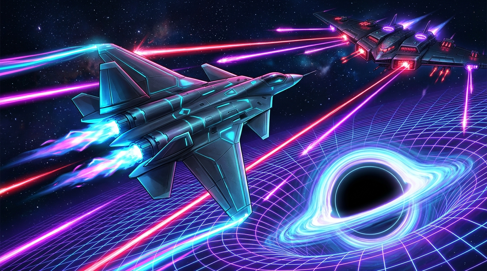

# AETHERBREAKER // SINGULARITY



A zero-dependency **WebGL2 HDR Cyber-Cosmic Aerial Roguelite & Spacetime Physics Arena** featuring multi-pass post-processing shaders, real multi-frame animated fighter aircraft, a spring-mass deformable spacetime grid, 16,000+ instanced GPU particles, and a live procedural Web Audio API synthwave soundtrack with FFT spectrum visualizer.

---

## Key Features

### 1. Real Aircraft Animations & High-Res Sprite Pipeline (`js/sprites.js`, `assets/planes/`)
- **4 Playable Supersonic Jets** with **5-angle 3D Roll Banking (`-30°` to `+30°`)** and **Variable-Geometry Wing Sweep**:
  - **VANGUARD-X (`F-99 Valkyrie`)** — Forward-swept interceptor with twin pulse blasters & rapid Phase Dash.
  - **TESLA-9 (`EA-77 Tempest`)** — Twin-boom electronic strike jet chaining fractal arc lightning + Orbital Drone.
  - **CHRONOS-0 (`SR-00 Eclipse`)** — Hypersonic stealth railgun jet with enlarged Singularity Wells.
  - **SOLARIS-V (`B-42 Valkyrie`)** — Quad-nozzle heavy missile gunship triggering Solar Novas on dash.
- **Dynamic Flight Effects**:
  - **Shock-Diamond Afterburners** (4-frame animated plasma plumes scaling with thrust & Phase Dash).
  - **Wingtip Contrail Vortex Ribbons** continuously shed from dynamic swept/banked wingtips.
  - **Supersonic Prandtl-Glauert Mach Cones** during Phase Dashes and Lancer supersonic charges.
  - **Spinning Rotor & Propeller Discs**, **Rotating AWACS Radomes**, **Swiveling Boss Dorsal Turrets**, **Wing Muzzle Flashes**, and **Battle-Damage Smoke & Sparks** below 55% hull.
- **8 Enemy Aircraft Classes & 3 Aerial Boss Dreadnoughts**:
  - `MiG-X Interceptor` (`Swarmer`), `Su-57 Viper` (`Lancer`), `RQ-9 Laser Relay` (`Weaver`), `AH-88 Gunship` (`Aegis`), `XB-70 Carrier Wing` (`Splitter`), `V-22 Singularity Tilt-Rotor` (`Gravity Mine`), `F-117 Rail-Jet` (`Prism Sniper`), and `C-5 Airborne Carrier` (`Carrier`).
  - Bosses: **Archon Sky-Fortress** (Wave 5), **Seraphim Sky-Leviathan 12-Ship Convoy** (Wave 10), and **Omega Valkyrie Orbital Mothership** (Wave 15+).

### 2. True 3D Depth-Buffered Perspective & POV Flight Modes (`js/renderer.js`)
- **Stable Decoupled 3D POV Flight & Gimbal Aim**: Defaults to **3D CHASE POV** (`W/S` throttle, `A/D` bank & turn + smooth reticle gimbal) and **3D COCKPIT POV** (first-person canopy frame, heading tape, artificial horizon pitch ladder, airspeed & altitude HUD), alongside `3D TACTICAL` and `2.5D OVERHEAD` via `V`.
- **Tactical Combat Pacing (`P`)**: Switch live between `TACTICAL (72%)` [Default], `CINEMATIC (54%)`, and `HYPER (100%)` speeds for readable canyon dogfighting.
- **24-Bit Depth-Buffered Shaders & HDR Bloom**: Hardware depth buffer occlusion, 4-pass separable HDR bloom, real-time Schwarzschild gravitational lensing around active Black Hole Singularities, and Bullet-Time indigo edge grading.

### 3. Solid 3D Augmented Reality Map & Forcefield Boundaries (`js/ar_map.js`)
- **Solid Shaded 3D Buildings & Tactical Cover**: Extruded 3D skyscrapers and canyon mesas with shaded faces, LiDAR wireframe edges, smooth aircraft hull deflection, and bullet-blocking cover across 4 Geo-Sectors (`N`).
- **Perimeter Forcefield Arena Walls**: 3D glowing perimeter barrier walls with corner anchor pylons and proximity warning telemetry as you approach arena bounds.
- **3D LiDAR Terrain Scan (`L`) & Deployable AR Defense Pylons (`B`)**: Sweeps a 3D cylindrical LiDAR ring across the map, illuminates structures, tags hostiles with 3D AR bounding-box telemetry (`ALT / DST`), and deploys autonomous AR arc-defense pylons.
- **Live Camera / Synthetic LiDAR AR Passthrough (`R`) + 3D Holo-Minimap**: Stream live webcam passthrough behind the transparent WebGL2 canvas (`getUserMedia`) or toggle the synthetic night-vision LiDAR AR feed alongside a rotating 3D isometric radar minimap.

### 4. Deformable Relativistic Spacetime Grid (`js/grid.js`)
- 58×34 Hooke's Law 3D spring-mass mesh that ripples from explosions, warps into black holes, wakes behind supersonic jets, and pulses to live bass energy.

### 5. Procedural 132 BPM Web Audio Synthwave Engine (`js/audio.js`)
- Zero audio files — pure Web Audio API synthesis with punchy kicks, breakbeat snares/hats, dual-sawtooth Reese basslines, stereo-delayed Phrygian arpeggiator, Bullet-Time low-pass muffling, and a live 32-band FFT spectrum visualizer.

---

## Controls

| Input | Action |
| :--- | :--- |
| `W / S` / `A / D` | **3D POV Flight**: Throttle & Bank/Turn (`3D Chase` / `3D Cockpit`) or 360° Flight (`3D Tactical` / `2.5D`) |
| `Left Click` / `C` | Primary Weapon / Toggle Auto-Fire |
| `Space` / `Shift` | **Phase Dash & Chrono-Parry** (dash near enemy bullets to trigger Bullet-Time & shockwave) |
| `Right Click` / `Q` | **Singularity Well** (spawns a gravitational lensing Black Hole) |
| `E` / `F` | **Overdrive: Aether Novabeam** (at 100% Overdrive) |
| `V` | Cycle **3D POV Camera** (`3D CHASE POV`, `3D COCKPIT POV`, `3D TACTICAL`, `2.5D OVERHEAD`) |
| `P` | Cycle **Combat Pacing** (`TACTICAL`, `CINEMATIC`, `HYPER`) |
| `N` | Switch **3D AR Sector Map** (*Neo-Tokyo*, *Canyon*, *Manhattan*, *Orbital Citadel*) |
| `L` | Trigger **3D LiDAR Terrain & Target Scan** |
| `B` | Deploy **3D AR Defense Beacon** at crosshair |
| `R` | Toggle **Live Camera / Synthetic LiDAR AR Passthrough** |
| `TAB` | Toggle live **FX & Physics Lab** shader/sandbox drawer |
| `1` / `2` / `3` | Draft Roguelite Augmentation Cores |
| `M` / `ESC` | Mute Audio / Pause |

---

## Running Locally

```bash
python3 -m http.server 8420
# Open http://localhost:8420 in any modern WebGL2 browser
```

To regenerate the SVG and PNG aircraft assets in `assets/planes/`:

```bash
python3 scripts/generate_plane_assets.py
```
